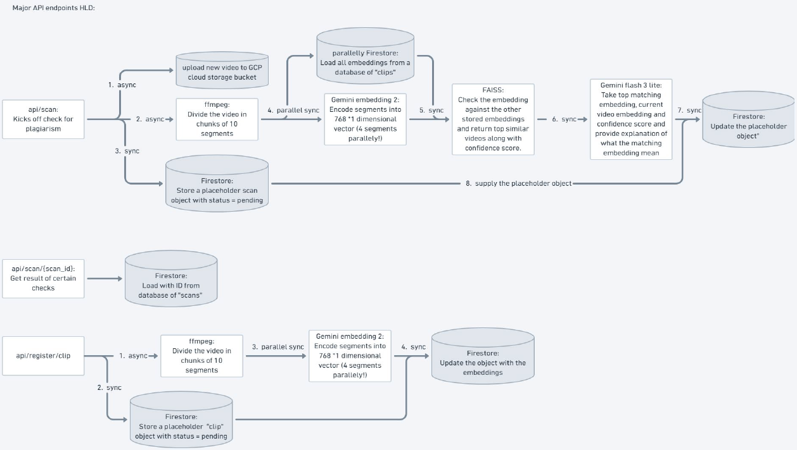

<div align="center">
  <sub><strong>TEAM VERTEX VERITAS</strong></sub><br />
  <sub><em>Media, Content &amp; Digital Experiences - H2S × Google Cloud AI Builder Cup</em></sub>
  <h1>ContentShield</h1>
</div>

> **Content protection, simplified. Find the match before it spreads.**

ContentShield gives video platforms and media businesses a practical way to
check new videos against a catalog of approved originals. A team saves the
videos it owns, uploads a video for review, and receives clear matching
moments, an explanation, and next steps in one place.

## A business owner's moment of doubt

Maya runs a small media business. She is tired of seeing her video
ideas and distinctive style copied across other accounts, but reviewing every new upload by hand is impossible. She wishes the platform could check new videos for her before a copied version spreads.

Her platform saves her video as an original and checks other creator's uploads against her current videos. Maya's platform's review team sees the matching moments in all matching videos, an explanation of why they were matched, and any limitations of the assessment. They can review the matches and prepare a takedown notice draft (DMCA) for the selected original.

## The problem we're solving

Video platforms and media businesses are dealing with a growing volume of plagiarized,
reposted and AI-assisted content, while review teams still have to find the
relevant moments, understand why a video was flagged, and decide how to
respond. That creates a slow operational bottleneck and makes black-box similarity
scores hard to trust.

ContentShield turns that process into a clear three-part workflow:

**assess -> explain -> act**

ContentShield's APIs can fit into a platform's upload or moderation workflow.
The browser dashboard then gives review teams a clear view of each result:
matching video sections, an explanation, and any limitations. This helps teams
review possible copies instead of relying only on an unexplained score.

## Meet ContentShield

ContentShield is a business content protection platform for comparing a
**suspicious video** with a private catalog of **original videos**. It helps a platform
or media business decide what its review team should look at next when a clip
may have been reposted, edited, cropped, or reused.

The product is useful for:

- video platforms that want to check incoming uploads against their existing
  video catalog
- media companies, studios, and rights-management businesses protecting their
  video libraries
- trust-and-safety, moderation, and legal-operations teams triaging possible
  copies
- teams demonstrating multimodal search on private media

ContentShield is an investigation aid, not an automated legal decision. A
similarity score is not a probability of infringement, and every result should
be reviewed by the business's rights or legal team.

## From suspicion to action

1. Upload known existing original videos to the private originals catalog.
2. Add a suspicious video for review against that catalog.
3. Review the score, risk level, matching moments, and explanation.
4. You can open all matching video scans to inspect its video comparison and evidence.
5. Generate a reviewable takedown notice draft (DMCA) for the selected match when the
  evidence is sufficient.
6. Move a submitted video into the originals catalog if you own it, are confident it is
  original.

Platforms can add original videos they own to the originals catalog. These are
saved as reference videos, not videos that need to be reviewed. Each platform
can choose how strict it wants the match levels to be; the settings in this
project are starting points for a prototype.

## Behind the scenes

1. **Upload and store:** the API validates the file, measures its duration, and
  stores it in a private Google Cloud Storage bucket.
2. **Create fingerprints:** Gemini on GCP Agent Platform creates an embedding for each
   temporal video segment. The segment metadata and embeddings are recorded with
   the clip in Firestore.
3. **Search:** the backend builds an in-memory FAISS index over registered
  original segments and searches it with the uploaded video's embeddings.
4. **Score:** segment similarities are aggregated into a content score and an
  initial similarity level.
5. **Explain:** when requested, Gemini compares both private videos and the
   retrieval result, returning validated JSON with a decision, timestamps,
   observations, and limitations.
6. **Review:** the frontend shows the uploaded video, matching original,
  evidence, and optional takedown notice draft (DMCA).

## How the pieces connect

ContentShield has two parts: a browser dashboard where business teams review
results, and a Google Cloud backend that stores videos, compares them, and
returns the match information. Here is how the main parts work together:

```text
Browser
  |
  +-- Firebase Hosting: static Next.js export
  |       |
  |       +-- HTTPS API calls (CORS)
  |
  +-- Cloud Run: FastAPI container
          +-- Gemini / GCP Agent Platform: video embeddings and explanations
          +-- Cloud Storage: private original and submitted-video objects
          +-- Firestore: clip, scan, evidence, and draft metadata
          +-- FAISS: in-memory segment retrieval
```

### Request and processing flow

**Registering an original (`POST /api/clips/register`):**

1. The API validates the MP4 or MOV upload and stores it in a private Cloud
  Storage bucket.
2. The platform saves a temporary record in Firestore so the catalog can show
  that the video is still being processed.
3. FFmpeg checks the uploaded original video's duration and divides it into
  smaller time-based sections for comparison.
4. Gemini creates comparison data for several video sections at the same time,
  in controlled batches.
5. Once processing is complete, Firestore saves the video's comparison data and
  the original is ready to be compared with future uploads.

**Checking a video (`POST /api/scan`):**

1. The API stores the submitted upload in Cloud Storage and writes a pending scan
  record in Firestore, then returns a `scan_id`.
2. The background scan worker creates ordered segment embeddings for the submitted
  video while loading compatible original embeddings from Firestore.
3. FAISS compares the submitted segments with the original corpus and returns the
  strongest matches and timestamp ranges.
4. When the comparison is finished, the platform saves the score, match level,
  possible matches, and completion status. The dashboard then shows the result.
5. Gemini compares the uploaded video with the matching original and creates an
   explanation shown with the result. It includes the matching moments, what
   was found, and anything the system could not confirm.



## The technology behind it

| Layer            | Technology                                            | Role                                                                                     |
| ---------------- | ----------------------------------------------------- | ---------------------------------------------------------------------------------------- |
| Frontend         | Next.js, React, TypeScript, Tailwind CSS              | Displays the application interface for users                                             |
| Frontend hosting | Firebase Hosting                                      | Serves the static `frontend/out` export                                                  |
| API              | Python, FastAPI, Uvicorn                              | Upload, catalog, scan, review, explanation, and draft endpoints                          |
| Compute          | Google Cloud Run                                      | Runs the backend application                                                             |
| AI               | Gemini through GCP Agent Platform / Google Gen AI SDK | Creates video embeddings and verdict explanations                                        |
| Storage          | Google Cloud Storage                                  | Keeps media private and provides temporary video-viewing links                           |
| Metadata         | Cloud Firestore                                       | Stores originals, scans, matches, evidence, and drafts                                   |
| Retrieval        | FAISS and NumPy                                       | Compares video sections to find the closest matches between uploaded and original videos |
| Media processing | FFmpeg and ffprobe                                    | Checks how long each video is and splits it into sections for comparison                 |
| Observability    | Prometheus                                            | Collects backend request counts, error rates, and response-time metrics                  |
| Automation       | GitHub Actions                                        | Builds and deploys the static frontend to Firebase after `main` changes                  |


Google Cloud is the system boundary for the backend: Cloud Run hosts the API,
GCP Agent Platform provides Gemini, Cloud Storage holds media, and Firestore stores
application state. Firebase Hosting is used for the separately deployed static
frontend.

## Inside the repository

```text
.
|-- backend/
|   |-- app/                 # FastAPI routes and services
|   |-- scripts/             # Smoke checks and operational helpers
|   |-- tests/               # Backend unit and API tests
|   |-- Dockerfile           # Cloud Run image definition
|   |-- DEPLOYMENT.md        # Backend setup and Cloud Run checklist
|   `-- DEMO_RUNBOOK.md      # Repeatable backend demo flow
|-- frontend/
|   |-- src/                 # Next.js pages and components
|   |-- DEPLOYMENT.md        # Local, Firebase, and GitHub Actions setup
|   `-- DEMO_RUNBOOK.md      # Repeatable local and hosted demo flow
|-- .github/workflows/       # Firebase Hosting workflow
|-- firebase.json            # Firebase Hosting output configuration
`-- README.md                # Product and contributor overview
```

## The API behind the experience

| Method   | Endpoint                                | Purpose                                                               |
| -------- | --------------------------------------- | --------------------------------------------------------------------- |
| `GET`    | `/`                                     | API landing response with links to docs and health                    |
| `GET`    | `/health`                               | Check that the service is alive                                       |
| `POST`   | `/api/clips/register`                   | Upload and fingerprint an original                                    |
| `GET`    | `/api/clips`                            | List originals for the catalog                                        |
| `GET`    | `/api/clips/{clip_id}`                  | Read one original's metadata                                          |
| `DELETE` | `/api/clips/{clip_id}`                  | Remove an original and its stored object                              |
| `POST`   | `/api/scan`                             | Upload a video for review and start matching                          |
| `GET`    | `/api/scans`                            | List recent scan summaries                                            |
| `GET`    | `/api/scans/{scan_id}`                  | Read a scan, or focus it with `match_id`                              |
| `POST`   | `/api/scans/{scan_id}/explain-verdict`  | Generate and save Gemini evidence for a selected original             |
| `POST`   | `/api/scans/{scan_id}/dmca`             | Generate and save a takedown notice draft (DMCA) for a selected match |
| `POST`   | `/api/scans/{scan_id}/move-to-original` | Promote a submitted video into the originals catalog                  |


Developers can open `/docs` to see what information each API action needs and
returns. The frontend uses these API actions directly, so the backend is
configured to accept requests from the frontend website.

## Try it locally

### Prerequisites

- Python 3.12 or newer
- Node.js 20 or newer and npm
- FFmpeg available on the backend `PATH`
- A Google Cloud project with GCP Agent Platform, Cloud Storage, Cloud Firestore, and
  Cloud Run enabled for AI-backed local runs

The backend needs local configuration in `backend/.env`; the frontend only needs
the public API base URL in `frontend/.env.local`. Use the example environment
files and never commit credentials, service-account JSON, private media URLs, or
other secrets.

### Start the backend

```powershell
cd backend
python -m venv .venv
.\.venv\Scripts\Activate.ps1
pip install -r requirements.txt
uvicorn app.main:app --reload --port 8000
```

### Start the frontend

In a second terminal:

```powershell
cd frontend
Copy-Item .env.local.example .env.local
# Set NEXT_PUBLIC_API_URL=http://localhost:8000 in .env.local when needed.
npm ci
npm run dev
```

Open `http://localhost:3000`, confirm the backend health check, register an
original, and then upload a video for review. The deployment and demo guides below
contain the complete configuration and troubleshooting steps.

## Take it live

- **Backend:** build `backend/Dockerfile` and deploy it as a Google Cloud Run
  service. Attach a runtime service account with only the required Storage,
  Firestore, and GCP Agent Platform permissions.
- **Frontend:** build the static Next.js export with
  `NEXT_PUBLIC_API_URL` set to the intended API, then deploy `frontend/out` to
  Firebase Hosting. The GitHub Actions workflow performs this after pushes to
  `main` when its repository secrets are configured.

The frontend and backend are deployed independently. A new frontend build does
not deploy a new API revision, and a new Cloud Run revision does not rebuild the
frontend. After either deployment, verify `/health`, CORS, catalog loading,
media playback, and one known matching scan.

## Go deeper: deployment and demo guides

Use the README for the product overview and these focused guides for the
repeatable commands and operational checklists:

- [backend/DEPLOYMENT.md](backend/DEPLOYMENT.md) - backend environment
  variables, local startup, Docker/Cloud Run deployment, IAM, cost-safe
  settings, and production-boundary notes.
- [backend/DEMO_RUNBOOK.md](backend/DEMO_RUNBOOK.md) - seed order, example
  API calls, and the end-to-end backend demonstration flow.
- [frontend/DEPLOYMENT.md](frontend/DEPLOYMENT.md) - local Next.js setup,
  static export, Firebase Hosting, GitHub Actions, CORS, and troubleshooting.
- [frontend/DEMO_RUNBOOK.md](frontend/DEMO_RUNBOOK.md) - local and hosted demo
  steps, release checks, and common frontend deployment symptoms.

## How we verify it

Run backend tests from the repository root or from `backend`:

```powershell
cd backend
python -m unittest discover -s tests -v
python scripts/smoke_check.py --base-url http://localhost:8000
```

Run frontend checks:

```powershell
cd frontend
npm run lint
npm run build
```

The checks cover upload validation, risk thresholds, FAISS scoring, segment
embedding concurrency, Firestore serialization, temporary media-link behavior,
selected-match review APIs, verdict evidence validation, takedown-notice (DMCA) generation,
and frontend TypeScript/lint/build correctness.

## Current boundaries

- MP4 and MOV uploads are accepted.
- Each upload is limited to **50 MiB** by default.
- Each video is limited to **10 seconds** by default.
- Matching uses **5-second configured segments**, with a minimum of ten sampled
  segments for a stable embedding sequence.
- Gemini evidence is capped at **eight** evidence items per explanation.
- Temporary video-viewing links expire after **15 minutes** by default.

## Next steps and future scope

- Use a more advanced vector search solution that finds similar videos faster
  than the current FAISS prototype.
- Replace polling with webhooks so video platforms are notified when video
  processing is complete.
- Add richer video embeddings that capture more dimensions of video content and
  improve matching accuracy.

## Keeping media and credentials safe

- Keep the media bucket private; playback uses short-lived temporary links.
- Use a Cloud Run attached service account instead of committing a key file.
- Configure `CORS_ORIGINS` with only the local or Firebase origins that need
access.
- Keep `.env`, `.env.local`, service-account files, generated indexes, and demo
media out of Git.
- Do not put API credentials or private storage URLs in the frontend bundle.

## License

MIT
